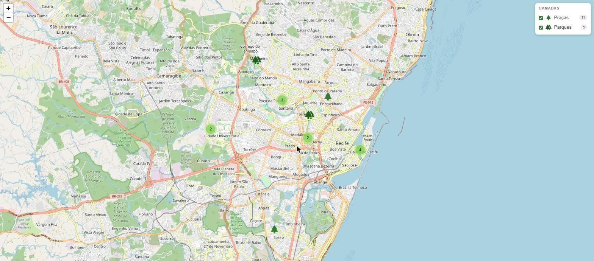
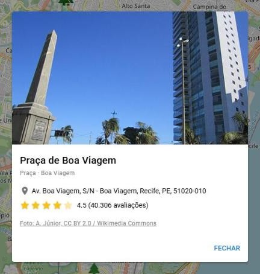

<h1 align="center">🗺️ Open Mapa</h1>

<p align="center">
  Mapa interativo das praças e parques do Recife, feito com <strong>Quasar</strong>, <strong>Vue 3</strong> e <strong>Leaflet</strong>.
</p>

<p align="center">
  
  
  
  
  
</p>

<p align="center">
  
</p>

## ✨ Funcionalidades

- **Camadas selecionáveis**: menu no canto do mapa para mostrar ou esconder **Praças** e **Parques**, com a quantidade de pontos de cada uma.
- **Agrupamento de pontos**: pontos próximos viram um círculo com a contagem (via [Leaflet.markercluster](https://github.com/Leaflet/Leaflet.markercluster)) e se separam ao aproximar o mapa.
- **Prévia ao passar o mouse**: foto, nome, nota e bairro do local.
- **Detalhes ao clicar**: diálogo com foto, endereço, nota em estrelas, número de avaliações e crédito da foto.
- **Fotos livres** do [Wikimedia Commons](https://commons.wikimedia.org/), com autor e licença.

<p align="center">
  
</p>

## 🚀 Como rodar

Pré-requisito: **Node.js 22.12+** (ou 24+).

```bash
# instalar as dependências
npm install

# modo desenvolvimento (abre em http://localhost:8080)
npm run dev

# verificar o código
npm run lint

# build de produção (gera dist/spa)
npm run build
```

O build gera arquivos estáticos em `dist/spa`, que podem ser publicados em qualquer hospedagem estática (GitHub Pages, Netlify, Vercel…). Eles precisam ser servidos por HTTP; abrir o `index.html` direto pelo `file://` não funciona.

## 📍 Dados

Os pontos ficam em [`src/data/pracas.json`](src/data/pracas.json). Cada item segue este formato:

```json
{
  "nome": "Praça do Marco Zero",
  "tipo": "praça",
  "bairro": "Recife Antigo",
  "endereco": "Av. Alfredo Lisboa - Recife, PE, 50030-150",
  "nota": 4.7,
  "avaliacoes": 77600,
  "lat": -8.0631023,
  "lng": -34.8712013,
  "foto": "https://… (opcional)",
  "fotoCredito": "Autor, licença (opcional)",
  "fotoFonte": "https://commons.wikimedia.org/wiki/File:… (opcional)"
}
```

- `foto` aceita um link ou um arquivo local em `public/` (ex.: `"fotos/derby.jpg"` para `public/fotos/derby.jpg`).
- Pontos sem foto continuam funcionando, só sem imagem.

### Adicionar uma nova camada

1. Adicione os itens no JSON com um `tipo` novo (ex.: `"escola"`).
2. Inclua uma linha no objeto `camadas` em [`src/components/Mapid.vue`](src/components/Mapid.vue):

```js
const camadas = {
  'praça': { label: 'Praças', icon: 'park', color: '#2e7d32' },
  parque: { label: 'Parques', icon: 'forest', color: '#1b5e20' },
  escola: { label: 'Escolas', icon: 'school', color: '#1565c0' } // nova camada
}
```

O `icon` é qualquer nome do [Material Icons](https://fonts.google.com/icons). A camada aparece no menu automaticamente.

## 🗂️ Estrutura

```
├── index.html               # HTML base
├── quasar.config.js         # configuração do Quasar
├── public/                  # arquivos estáticos (favicon, fotos locais)
├── docs/                    # imagens deste README
└── src/
    ├── components/Mapid.vue # mapa, camadas, prévia e diálogo
    ├── data/pracas.json     # praças e parques
    ├── layouts/MainLayout.vue
    ├── pages/               # Index.vue (mapa) e Error404.vue
    └── router/              # rotas (modo hash)
```

## 🛠️ Tecnologias

| | |
|---|---|
| [Quasar 2](https://quasar.dev/) + [Vite](https://vite.dev/) | framework de UI e build |
| [Vue 3](https://vuejs.org/) | componentes reativos |
| [Leaflet](https://leafletjs.com/) | mapa interativo |
| [Leaflet.markercluster](https://github.com/Leaflet/Leaflet.markercluster) | agrupamento de pontos |
| [OpenStreetMap](https://www.openstreetmap.org/) | mapa base |

## 📜 Créditos

- Mapa base © [colaboradores do OpenStreetMap](https://www.openstreetmap.org/copyright).
- Informações dos locais (nota, avaliações, endereço): Google Maps.
- Fotos: [Wikimedia Commons](https://commons.wikimedia.org/). Autor e licença de cada foto aparecem no app e no campo `fotoCredito` do JSON.
